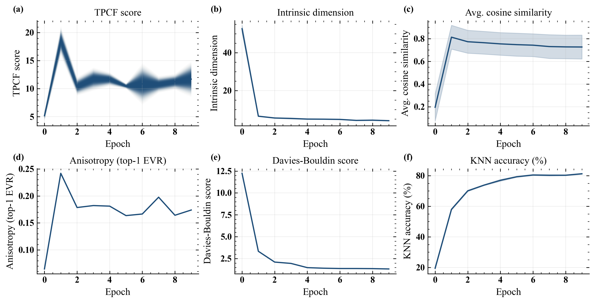

# spectra_for_features

Measures the quality of deep-learning representations of galaxy images (Galaxy10 DECaLS / Galaxy Zoo) using
astronomy-style statistics: the two-point correlation function (TPCF) score, intrinsic dimension (TwoNN)
and kNN accuracy.

## Metrics over training



Good representations tend to have lower-dimensional, anisotropic manifolds: as KNN accuracy improves over training, the intrinsic dimension falls and the variance concentrates in a small number of directions.

The figure is produced by [notebooks/Model_TPCF_scores.ipynb](notebooks/Model_TPCF_scores.ipynb).

## Layout

| Path | Contents |
|---|---|
| `Training_/` | Training and feature-extraction scripts; each `x.py` reads its settings from `x.yaml` |
| `backbone/custom_metrics/` | TPCF score (`AstroMLmod*`), intrinsic dimension (`TwoNN`, `Intrinsic_dimension`) |
| `backbone/data_handle/` | Datasets, loaders and augmentations (`GalaxyZoo`, `Custom`) |
| `backbone/visuals/` | Plotting helpers |
| `notebooks/` | Analysis notebooks and plotting scripts |
| `*.sh` | SLURM job scripts (ilifu) |

## Scripts

| Script | SLURM | What it does |
|---|---|---|
| `Training_/byol.py` | `byol.sh` | BYOL self-supervised training (EfficientNet-B0) |
| `Training_/dino.py` | `dino.sh` | DINO self-supervised training (EfficientNet-B0) |
| `Training_/supervised.py` | `supervised.sh` | Supervised training with optional label noise |
| `Training_/gz_foundation_models.py` | `foundation_models.sh` | Extracts features from pretrained models (Zoobot, DINOv3, ImageNet) |

Each training run logs loss, kNN accuracy, ID and TPCF scores per epoch and writes checkpoints and CSVs to
`data_/` using the run's `artifact_prefix` (e.g. `byol_galaxy10_*`).

## Usage

```bash
sbatch byol.sh          # or dino.sh / supervised.sh / foundation_models.sh
```

Radio (RGZ FIRST images for self-supervision, MiraBest FRI/FRII for accuracy): convert the FITS once with
`Training_/rgz_fits_to_png.py`, then select the radio configs with `CONFIG`:

```bash
sbatch --export=ALL,CONFIG=Training_/byol_radio.yaml byol.sh
sbatch --export=ALL,CONFIG=Training_/dino_radio.yaml dino.sh
sbatch --export=ALL,CONFIG=Training_/gz_foundation_models_radio.yaml foundation_models.sh
```

Place `Galaxy10_DECals.h5` in `data_models/`. Python dependencies: `requirements.txt`, plus `byol-pytorch`
and `vit-pytorch`.
